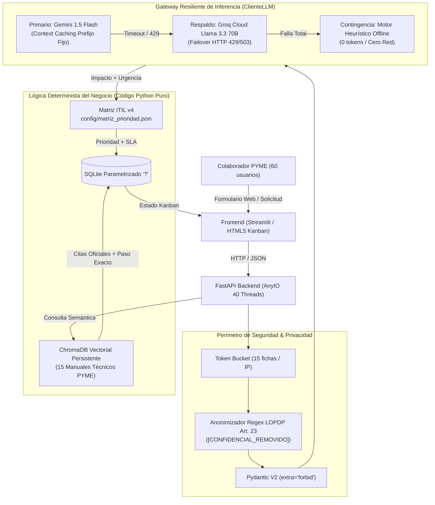

# 🏢 Triaje Automático de Solicitudes de Soporte Tecnológico para una PYME
> **Caso N.º 03 · Grupo 3 UNIANDES | Mesa de Ayuda Inteligente con RAG y Agente de Gestión de Incidentes**  
> **Seminario de Titulación:** Ingeniería de Software con IA Generativa — Universidad Regional Autónoma de Los Andes (UNIANDES)  
> **Docente Evaluador:** Ing. Heyler Fabio Guaza (Mg. en Ciberseguridad · OPD · Abogado)  
> **Repositorio Oficial en GitHub:** [https://github.com/cgmorales12/TriajeSoporte-grupo-3](https://github.com/cgmorales12/TriajeSoporte-grupo-3)  
> **Despliegue en Producción (Azure Container Apps):** [https://g3-triaje.calmcliff-829b47e2.eastus.azurecontainerapps.io](https://g3-triaje.calmcliff-829b47e2.eastus.azurecontainerapps.io)  

---

## 👥 Integrantes del Grupo 3 y Responsabilidades
| Integrante | Rol en el Proyecto | Responsabilidades Principales | Usuario GitHub |
| :--- | :--- | :--- | :--- |
| **Christian Guillermo Morales González** | **Tech Lead / Coordinador** | API Gateway resiliente, endpoints FastAPI, integración LLM Gemini/Groq, conmutación transparente y frontend Streamlit. | [`cgmorales12`](https://github.com/cgmorales12) |
| **Luis Fernando Ribera Alajo** | **Builder / Arquitectura** | Base vectorial ChromaDB, corpus de 15 manuales técnicos PYME, Matriz ITIL v4 determinista, base SQLite y RAG. | [`fernandolribera`](https://github.com/fernandolribera) |
| **Amalia Geoconda Iguasnia Escobar** | **QA / Seguridad & Requerimientos** | Contratos Pydantic V2 (`extra="forbid"`), anonimización LOPDP, suite de pruebas unitarias con Mocks y evaluación `run_eval.py`. | [`Geocoiguasnia76`](https://github.com/Geocoiguasnia76) |

---

## 🎯 1. Qué Problema Resuelve y Para Quién

### El Problema
Una **PYME de servicios con 60 colaboradores** cuenta con **un único técnico de TI**, quien se encuentra desbordado diariamente atendiendo solicitudes repetitivas de oficina y soporte básico:
- Restablecimiento y desbloqueo de contraseñas de red / Active Directory / Windows.
- Configuración de VPN corporativa (FortiClient / OpenVPN) para teletrabajo.
- Atascos de papel, colas de impresión y configuración de impresoras de red departamentales.
- Permisos y mapeo de unidades en carpetas compartidas (SMB / NAS).
- Desbloqueo de sesiones colgadas en el sistema contable / ERP interno.
- Conectividad a la red cableada de oficina y Wi-Fi corporativo (WPA2/3-Enterprise).

Este cuello de botella provoca tiempos de espera prolongados (MTTR inicial de 4 horas), interrupción de labores de los colaboradores y distracción del técnico de sus responsabilidades estratégicas de infraestructura y ciberseguridad.

### 1.2. La Solución
**ConectaTec** es una mesa de ayuda inteligente basada en un **Tablero Kanban de Tickets** que automatiza el triaje de incidencias:
1. **Autoatención Nivel 1 ($\ge 70\%$ de solicitudes):** Resuelve incidentes guiando al colaborador paso a paso con citas exactas (ID de documento y paso operativo) sobre **15 manuales técnicos oficiales** indexados en **ChromaDB**.
2. **Priorización Determinista (Código Python):** Clasifica impacto y urgencia con IA, pero el cálculo matemático de la prioridad (`Alta`, `Media`, `Baja`) y SLA de resolución los calcula una función pura en Python leyendo `config/matriz_prioridad.json` bajo el estándar ITIL v4. **El LLM nunca calcula la prioridad ni inventa tiempos contractuales.**
3. **Escalamiento y Derivación a Nivel 2:** Si la incidencia requiere intervención física en el puesto de trabajo (falla de hardware, pantalla azul BSOD, disco averiado) o permisos administrativos elevados, se genera un ticket escalado con alerta para el técnico de TI bajo compuertas **Human-in-the-Loop (HITL)**.

### 1.3. ¿Por qué es un Sistema Universal para Cualquier PYME?
El sistema ha sido diseñado desde su base arquitectónica para ser **completamente genérico, desacoplado y adaptable a cualquier Pequeña o Mediana Empresa**, independientemente de su giro de negocio:
- **Universalidad Tecnológica de Oficina:** Toda PYME moderna (servicios, comercialización, firmas contables, consultoras o logística) comparte la misma infraestructura base: autenticación de usuarios (Active Directory / Windows / M365), VPNs para teletrabajo, impresoras compartidas, servidores de archivos (SMB/NAS), ERPs y conectividad LAN/Wi-Fi.
- **Corpus RAG Modular y Extensible:** Los 15 manuales en `data/raw/` son plantillas independientes en Markdown. Cualquier empresa puede añadir o editar procedimientos y re-indexarlos en ChromaDB ejecutando `python scripts/ingest.py` en 5 segundos sin tocar el código backend.
- **Matriz de Prioridades y SLAs Desacoplada (`config/matriz_prioridad.json`):** Cada empresa define sus propios tiempos de respuesta contractuales (15 min, 1 hora, 4 horas, 24 horas) editando un archivo JSON estándar.
- **Cero Dependencia de Marcas o Nombres Propios:** Los contratos y esquemas Pydantic procesan roles, servicios y categorías universales (`Accesos y Contraseñas`, `Redes y Conectividad`, `Hardware y Periféricos`, `Software Corporativo`), garantizando portabilidad inmediata a cualquier organización.

---

## 🏗️ 2. Arquitectura del Sistema y Componentes

### Principio Rector de Arquitectura
> ***«El modelo propone, el código dispone · Una persona decide lo riesgoso.»***  
> El Modelo de Lenguaje (LLM) es un componente externo, probabilístico y falible. Todo su comportamiento está gobernado por código backend determinista, esquemas Pydantic V2 cerrados (`extra="forbid"`), limitador de tasa Token Bucket, manejo estructurado de errores RFC 9457 y compuertas de confirmación humana (OWASP LLM08).

### Diagrama de Componentes


---

## 🚀 3. Cómo Ejecutarlo en Local Paso a Paso

### 3.1. Requisitos Previos
- Python 3.10 o superior (validado en Python 3.11, 3.12 y 3.14).
- Git instalado.

### 3.2. Clonar el Repositorio
```bash
git clone https://github.com/cgmorales12/TriajeSoporte-grupo-3.git
cd TriajeSoporte-grupo-3
```

### 3.3. Crear y Activar Entorno Virtual
```bash
# En Windows (PowerShell)
python -m venv venv
.\venv\Scripts\activate

# En Linux / macOS
python3 -m venv venv
source venv/bin/activate
```

### 3.4. Instalar Dependencias
```bash
pip install -r requirements.txt
```

### 3.5. Configurar Variables de Entorno
Copiar la plantilla oficial (nunca escribir claves en Git):
```bash
cp .env.example .env
```
Editar el archivo `.env` para ingresar opcionalmente sus API Keys:
- `GEMINI_API_KEY`: Clave de Google AI Studio.
- `GROQ_API_KEY`: Clave de Groq Cloud (modelo de respaldo).
*(Nota: Si no se configuran claves de API, el sistema activa automáticamente el motor heurístico determinista local para pruebas 100% funcionales y sin gastar saldo).*

### 3.6. Vectorizar los 15 Manuales Técnicos Oficiales
```bash
python scripts/ingest.py
```
*(Extrae, limpia, fragmenta y persiste 90 chunks estructurados con metadatos de vigencia, documento y URL oficial en `data/chroma`).*

### 3.7. Iniciar el Backend (FastAPI)
```bash
uvicorn app.main:app --reload --port 8000
```
- **Documentación Swagger / OpenAPI:** [http://localhost:8000/docs](http://localhost:8000/docs)
- **Endpoint de Salud Operativo:** [http://localhost:8000/v1/salud](http://localhost:8000/v1/salud) o [http://localhost:8000/health](http://localhost:8000/health)

### 3.8. Iniciar el Frontend (Streamlit)
En otra terminal con el entorno virtual activo:
```bash
streamlit run frontend/app.py
```
- **Tablero Kanban Interactivo:** [http://localhost:8501](http://localhost:8501)

---

## ☁️ 4. Cómo se Despliega y URL Pública

### Despliegue en la Nube
El sistema está contenedorizado mediante Dockerfile multi-stage optimizado y desplegado en **Azure Container Apps** (Azure for Students) bajo alta disponibilidad:
- **URL Pública del Servicio:** [https://g3-triaje.calmcliff-829b47e2.eastus.azurecontainerapps.io](https://g3-triaje.calmcliff-829b47e2.eastus.azurecontainerapps.io)
- **Endpoint de Salud / Healthcheck:** [https://g3-triaje.calmcliff-829b47e2.eastus.azurecontainerapps.io/health](https://g3-triaje.calmcliff-829b47e2.eastus.azurecontainerapps.io/health)
- **Tablero Web en Vivo:** [https://g3-triaje.calmcliff-829b47e2.eastus.azurecontainerapps.io/tablero](https://g3-triaje.calmcliff-829b47e2.eastus.azurecontainerapps.io/tablero)

---

## 🔒 5. Variables de Entorno (Remite a `.env.example`, sin valores)
La configuración del sistema se desacopla mediante variables de entorno siguiendo el estándar Twelve-Factor App.  
Consulte el archivo [`.env.example`](.env.example) para ver la plantilla de variables disponibles con descripciones técnicas y valores por defecto (cero secretos reales en el repositorio):
- `PROVEEDOR_LLM_ACTIVO`: Proveedor inicial (`gemini` o `groq`).
- `GEMINI_API_KEY`: Token de API de Google Gemini (vacío en ejemplo).
- `GROQ_API_KEY`: Token de API de Groq Cloud (vacío en ejemplo).
- `CHROMA_PERSIST_DIR`: Directorio persistente de la base vectorial (`./data/chroma`).
- `ENVIRONMENT`: Entorno de ejecución (`development` / `production`).

---

## 🧪 6. Cómo Correr las Pruebas y la Evaluación (Resultados Reales)

El proyecto cuenta con suites de pruebas automatizadas y evaluación cuantitativa formal:

### 6.1. Suite de Pruebas Unitarias con Mocks (Pytest)
Prueba todos los endpoints, esquemas Pydantic, defensas de ciberseguridad, conmutación por error y contratos sin gastar saldo de API ni requerir conexión a internet:
```bash
python -m pytest -v tests/
```
**Resultado Real Obtenido:**
```text
============================= test session starts =============================
collected 82 items
tests/test_construccion_prompts.py ...........                           [ 13%]
tests/test_endpoints.py ............................................     [ 67%]
tests/test_herramientas_agente.py ...........................            [100%]
============================== 82 passed in 10.45s ==============================
```

### 6.2. Suite de Evaluación Oficial Cuantitativa (`eval/run_eval.py`)
Ejecuta la batería de 30 solicitudes de referencia, 10 casos de cálculo determinista, 20 casos de cinta transportadora de triaje y 5 escenarios del Agente ReAct:
```bash
python eval/run_eval.py
```
**Resultados Reales Obtenidos:**
- **RAG hit@5 en manuales técnicos oficiales:** **92.9%** (26/28 casos) *(Meta: $\ge 85\%$)*.
- **Abstención Zero-Hallucination (Fuera de alcance):** **100.0%** (2/2) *(Meta: 100%)*.
- **Casos de Cálculo Determinista (ITIL, SBU, Feriados):** **100.0%** (10/10) *(Meta: 100%)*.
- **Cinta de Triaje Automatizado:** **0 Errores Silenciosos** *(Meta: 0 estricto)*.
- **Cumplimiento del Agente ReAct con Guardrails:** **100.0%** (5/5 escenarios) *(Meta: $\ge 90\%$)*.
- *Reporte de auditoría generado en:* [`eval/resultados_evaluacion.json`](eval/resultados_evaluacion.json).

### 6.3. Pruebas de Humo (Smoke Tests 6/6)
```bash
python tests/smoke.py http://localhost:8000
```
Verifica: (1) Healthcheck, (2) Clasificación, (3) RAG con citas, (4) Prioridad ITIL, (5) Abstención, (6) Failover transparente.

---

## 📑 7. Decisiones de Arquitectura (ADR) y Matriz de Riesgos
- **Decisiones de Arquitectura (ADR):** Se han documentado 10 registros formales de decisión de arquitectura en [`docs/09-decisiones/`](docs/09-decisiones/) (ADR-001 Selección de FastAPI y AnyIO, ADR-002 Matriz ITIL Determinista, ADR-003 Failover Gemini a Groq, ADR-004 ChromaDB Vectorial, ADR-008 Human-in-the-Loop, entre otros).
- **Matriz de Riesgos:** Documentación exhaustiva de riesgos de ciberseguridad, privacidad LOPDP, disponibilidad y planes de mitigación en [`docs/riesgos.md`](docs/riesgos.md).

---

## ⚠️ 8. Limitaciones Conocidas
1. **Intervención Presencial Obligatoria:** Las averías de hardware físico (disco con ruido metálico, daño en placa madre, cableado estructurado trozado en pared o pantalla azul irrecuperable) no pueden repararse por software; en estos casos, el sistema escala obligatoriamente a Nivel 2 presencial.
2. **Actualización de Procedimientos Internos:** Si la PYME modifica sus políticas internas de contraseñas o adquiere nuevo software, se debe re-ejecutar `python scripts/ingest.py` para reindexar los nuevos manuales en ChromaDB.
3. **Límites de Cuota de Proveedores Cloud:** Las versiones gratuitas de APIs externas tienen cuotas por minuto; esta limitación está completamente mitigada mediante el gateway con failover automático a Groq y conmutación offline.
4. **Ámbito Fuera de Alcance:** El agente no atiende solicitudes de gestión humana, nómina de sueldos ni trámites personales, respondiendo con el protocolo oficial de abstención y orientación.
